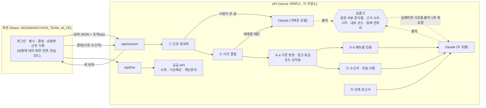

# WOOWANGTHON_TEAM_44_BE

2026 AI 우왕톤 44팀(그라파이트) 「당직메이트」의 시나리오 엔진, AI 파이프라인, 검증기, API입니다. 화면은 `WOOWANGTHON_TEAM_44_FE` 저장소에 있습니다.

지자체 야간 당직자 한 명에게 전화, 기관 통보문, 재난문자, 112·119 공조, 수위·특보 알림이 흩어져 들어올 때, AI는 같은 사건의 신호를 묶고, 처리할 부서와 매뉴얼 조항을 원문 그대로 찾아 연락할 때 볼 전달 사항을 정리합니다. 호우 때의 하천·지하차도 통제부터 상수도 누수, 가로등·신호등 고장, 빙판길, 정전, 화재 같은 평소 민원까지 같은 흐름으로 다룹니다. 권고 등급은 코드의 규칙표가 정하고, 담당 부서 전달, 보고, 통제 검토 요청, 보류는 당직자가 사유와 함께 고릅니다. 연락은 당직자가 전화나 메신저로 직접 하고, 시스템은 결정과 기관별 연락 결과(전달함, 회신 대기)를 기록해 인계 보고서를 만들며, 미결 항목은 당직실 인계함으로 다음 근무자에게 넘깁니다. AI는 어떤 조치도 직접 실행하지 않습니다.

## 바로 확인하기

1. https://woowangthon-44-fe.vercel.app 를 엽니다. 로그인 화면에서 「체험 계정으로 시작」을 누르면 접속 코드 없이 들어가고 AI 기능도 그대로 동작합니다(심사 기간까지 열어 둡니다). 기관 접속 코드는 최종 제출 폼의 테스트 계정 칸에 적어 두었습니다.
2. 처음 들어가면 연습을 권합니다. 「2026년 7월 9일 새벽, 청주」를 고르면 그날 보도로 확인한 시각과 장소, 한강홍수통제소 실측 수위로 05:00~08:40에 시청 당직실 한 자리로 들어왔을 신호 26건이 시각대로 흐릅니다. 연습은 약 6분이 걸리고, 재생이나 배속 같은 조작 없이 연습할 순간에 저절로 멈춥니다. 「한파 속 겨울 새벽, 청주」는 상수도 누수, 신호등 고장, 차량 화재, 빙판길, 정전처럼 당직실에 흔히 들어오는 신고 14건으로 만든 가상 연습입니다.
3. 멈추면 화면 위 안내에 따라 결정을 직접 기록합니다. 미평천 통제 검토 요청, 무심천 보류, 가덕면 요양원 축대 보고, 보류한 무심천의 재촉과 재결정, 받은 전화 직접 적기, 문암철교 하부도로, 여러 사건이 동시에 쌓인 상황판을 차례로 겪습니다.
4. 끝나면 밤 전체 흐름과 검증 기록을 보고 인계 보고서를 만듭니다. 보고서 창의 「다음 근무자에게 넘기기」를 누르면 결정 전 사건, 보류한 사건, 회신 대기가 인계함에 들어가고, 「다음 근무자 화면 보기」에서 다음 근무자가 로그인했을 때의 첫 화면과 「이어받기」를 볼 수 있습니다. 「당직메이트 없이 받았다면」에서는 같은 신호가 다섯 창구(전화, 기관 통보, 112·119, 재난문자, 시스템 알림)로 흩어져 들어오는 모습을 봅니다.
5. 「실제 근무로 돌아가기」를 누르면 평시 근무 화면이 열립니다. 가운데에 넘겨받은 것, 받은 전화 적기, 들어온 것이 있고, 오른쪽 근무 도우미에 청주 기상특보와 충북 긴급재난문자(실제 공공 API 값), 자주 연락하는 곳이 있습니다. 하천 수위는 호우·홍수 특보가 있거나 침수 사건이 생겼을 때만 나옵니다. 「받은 전화 적기」에 아무 메모나 넣으면(예: 「용암동 주민: 아파트 앞 인도에서 상수도관이 터져 물이 차도로 흐른다」) 같은 AI 단계를 거쳐 사건으로 묶이고, 상수도사업본부 전달 권고와 해당 조항이 있는 결정 화면이 열립니다.

로그인하지 않고 「저장된 연습 기록 둘러보기」를 누르면 11월 9일 실제 재생을 끝까지 마친 세션을 AI 호출 없이 볼 수 있습니다(결정은 시연 스크립트가 입력했습니다). 연습 목록의 「2023년 7월 15일 새벽, 오송」은 공식 기록으로 재구성한 신호 11건이며, 권고가 오를 때마다 멈춥니다.

## 왜 실제 기록으로 재구성했는가

처음에는 가상 도시 시나리오로 만들었습니다. 오송 참사를 시연에 그대로 쓰면 분위기가 무거워지고 실제 기관의 대응을 평가하는 것처럼 보일 수 있어서였습니다. 그런데 가상 도시는 「실제로 쓸 수 있는가」를 보여 주지 못했습니다. 그래서 인명 피해 없이 지나간 2026년 7월 9일 새벽 청주를 골랐습니다. 0시부터 8시까지 133mm가 내린 이 밤에 시에만 53건의 신고가 들어왔고(뉴시스), 하천 수위는 몇십 분 만에 심각 기준을 넘었습니다. 큰 사고가 없던 밤에도 당직자는 이만큼의 신호를 받습니다. 신호 문장은 원문이 아니라 보도된 사실로 쓴 합성 문장이고, 일상 민원 3건은 시연을 위해 더한 가상 신호이며, 화면에 그 구분을 표시합니다.

## 구조

```
scenarios/        시나리오 JSON (파일 교체만으로 시나리오 변경)
  cheongju-20260709.json       연습: 2026.7.9 새벽 청주, 보도·실측 수위 기반 재구성, 신호 26건
  osong-20230715-record.json   연습: 2023.7.15 오송, 공식 기록 기반 재구성, 신호 11건
  cheongju-winter.json         연습: 한파 속 겨울 새벽, 흔한 신고 유형으로 만든 가상 신호 14건
  cheongju-live.json           실제 근무: 청주 당직 매뉴얼(풍수해와 생활 민원)·연락처·담당 부서 표·지명 사전만 있고 신호 없이 시작
scripts/
  build-cheongju.py            청주 시나리오 생성기(보도 출처, 지명 좌표, 실측 수위를 합침)
  patch-osong.py               오송 시나리오에 좌표와 미호천교 실측 수위를 넣음
src/
  engine.js       세션 상태, 신호 처리 순서, 결정 기록, 재촉, 검증 집계
  stages/
    normalize.js  ① 신호 정규화 (수위·특보 알림은 규칙, 사람이 쓴 글은 LLM + 근거 구절 검증)
    associate.js  ② 사건 결합 (장소·시설 겹침은 규칙, 애매하면 LLM)
    criteria.js   ③-a 통제 기준 도달 판정과 권고 등급 (코드 규칙표만)
    advise.js     ③-b 매뉴얼 인용 (원문 부분 문자열 검증) / ④ 수신처·전달 사항 (수치·시각·내부 코드 검증)
    handover.js   ⑤ 인계 보고서 (표는 코드, 요약만 LLM + 수치·시각 검증, AI 검증 기록)
  llm.js          Claude API 구조화 출력, 검증 실패 시 사유를 붙여 1회 재요청, 호출 상한
  live.js         공공 API 참고 조회 (/api/live)
  metrics.js      평가 지표 계산
  handoff.js      다음 근무자에게 넘길 미결 항목(코드로 뽑음), 인계함 넣기·이어받기
  store.js        인계함 저장소(Upstash Redis REST, 없으면 프로세스 메모리)
api/              Vercel 서버리스 함수 (상태는 클라이언트가 보관)
  session.js      세션 시작, 신호 진행, 전화 메모, 결정과 연락 결과, 회신 받음, 전달 사항 다시 정리, 인계 보고서, 다음 근무자에게 넘기기
  access.js       체험 계정 기간 확인, 기관 접속 코드 확인
  handoff.js      당직실 인계함 열기, 항목 이어받기, 받음 표시
  live.js         충북 실시간 수위·특보·재난문자
test/             단위 테스트, API 테스트, 재생 e2e
eval/run.js       같은 시나리오 N회 재생 평가 → eval/results-*.json
```

## 아키텍처



## AI가 하는 일과 코드가 하는 일

기준 도달 여부와 권고 등급(관찰, 담당 부서 전달 권고, 보고 권고, 통제 검토 요청 권고), 그리고 결정이 권고를 따라오지 못할 때의 재촉은 코드의 규칙표가 정합니다. 권고가 왜 나왔는지를 당직자가 한 줄로 확인할 수 있어야 하고, 같은 사실이 들어오면 언제나 같은 등급이 나와야 하기 때문입니다. 규칙표는 하천변 도로·둔치의 홍수특보·기준 수위, 하부도로 침수 신고, 토사·축대 붕괴, 하천 넘침 우려, 통행 막힘, 인명 위험, 화재·가스를 보고 이상으로, 상수도, 도로 시설, 가로등·신호등, 결빙·제설, 정전, 동물, 소음, 보호가 필요한 사람 신고를 담당 부서 전달로 다룹니다. 전달할 부서는 시나리오의 담당 부서 표(`routing`)에서 고르고, 검증기는 전달 권고인데 담당 부서가 수신처에 없으면 다시 묻습니다. LLM은 사람이 쓴 신호의 이해, 애매한 사건 결합, 조항 선택과 인용, 전달 사항 정리, 인계 요약을 맡습니다.

화면도 이 구분을 그대로 보여 줍니다. AI가 만든 내용에는 점선 「AI」 표지, 규칙표가 정한 등급·판정·재촉에는 실선 「규칙표」 표지, 당직자의 결정에는 채운 「당직자」 표지를 붙였습니다. 신호가 들어올 때 어느 사건에 묶었는지 알리는 한 줄도 규칙으로 묶었는지 AI가 묶었는지에 따라 표지가 다릅니다.

LLM 출력은 모두 검증기를 거칩니다. 인용은 매뉴얼 원문의 부분 문자열이어야 화면에 오르고, 신호에서 뽑은 사실은 본문에 근거 구절이 그대로 있어야 하며, 전달 사항과 요약 속 수치와 시각은 근거 신호에 있어야 하고, 수신처는 등록된 연락처 안에서만 고릅니다. 화면 문장에 기준·조항·연락처 id나 영문 판정 코드가 섞여도 검증에 걸립니다. 검증에 실패하면 사유를 붙여 한 번 다시 묻고, 그래도 실패한 인용은 화면에 올리지 않으며, 전달 사항은 경고를 달아 보여 줍니다. 이 과정의 집계는 세션 상태(`state.metrics`)에 쌓여 화면 「근무 기록」의 검증 기록과 인계 보고서의 「AI 검증 기록」에 그대로 나옵니다.

## 설계 결정

- **권고 등급은 규칙표, AI는 근거와 전달 사항.** LLM이 등급까지 정하면 같은 상황에서 등급이 흔들리고 이유를 설명하기 어렵습니다. 통제 기준은 시설마다 숫자로 정해져 있으므로 코드로 판정하고, AI에게는 사람이 쓴 신호를 읽고 근거를 찾아 글로 옮기는 일만 맡겼습니다.
- **인용은 부분 문자열 검사.** 매뉴얼을 요약해서 보여 주면 당직자가 원문과 대조할 수 없습니다. 원문에 글자 그대로 있는 구절만 올리고, 문장 중간에서 잘린 인용은 원문 문장 전체로 넓힙니다.
- **수치·시각은 근거 신호 안에서만.** 보고 전화에서 틀린 수위나 시각을 읽는 것이 가장 위험하다고 보고, 전달 사항과 요약의 수치·시각 토큰을 근거 자료와 하나씩 대조합니다. 반올림이나 추정도 허용하지 않습니다.
- **수위는 실측, 기준은 관측소 기준 그대로.** 수위 알림 신호와 그래프는 한강홍수통제소 10분 자료이고, 관심·주의·경계·심각 기준도 같은 API의 관측소 값을 씁니다. 지하차도·하부도로 노면 침수 기준은 2026년 7월 행정안전부가 강화한 5cm를 데모 매뉴얼에 반영했습니다.
- **대본 대신 전달 사항, 발송 대신 연락 결과.** 처음에는 전화 스크립트와 문자 초안을 만들었지만, 당직자는 대본을 읽기보다 핵심을 보며 통화하고, 받는 기관이 같은 시스템을 쓴다면 전화나 문자일 이유도 없다는 지적을 받았습니다. 그래서 AI는 「무슨 일, 어디, 언제, 누가 알려 옴」 두세 줄과 요청 한 줄로 전달 사항을 정리하고, 당직자는 직접 연락한 뒤 기관마다 전달함 또는 회신 대기와 한 줄 메모를 남깁니다. 회신 대기인 곳은 사건 줄과 인계 보고서의 확인 사항에 남습니다. 시스템이 직접 보내는 기능은 AI 출력이 사람 확인 없이 밖으로 나갈 경로가 되므로 만들지 않았습니다. 상황전파시스템 연동과 통화 기록 전사는 다음 단계입니다.
- **AI가 읽는 동안 시계를 멈춤.** 신호 한 건 처리에 5~15초가 걸립니다. 재생 시계를 계속 흘리면 처리 지연이 화면에서 사라지므로, 처리 중에는 시계를 멈추고 읽고 있는 신호의 원문을 먼저 보여 줍니다. 등급이 그대로이고 기준 판정만 바뀌면 조항은 다시 찾지 않고 전달 사항만 고쳐 대기 시간을 줄였습니다.
- **상태는 클라이언트가 보관, 인계함만 서버에.** 근무 중의 세션 상태 JSON은 요청마다 주고받고 서버에 남기지 않습니다. 다음 근무자에게 넘기는 인계만은 다른 사람이 다른 시각에 열어야 하므로 서버의 인계함(Upstash Redis, 60일 뒤 삭제)에 둡니다. 인계함에는 사건 제목, 미결 사유, 회신 대기 기관과 메모만 들어가고, 미결 항목은 AI가 아니라 코드가 세션 상태에서 뽑습니다. 실제 근무는 기관 인계함 하나를 같이 쓰고, 연습에서 넘긴 인계는 브라우저마다 따로 둡니다.
- **하천만이 아니라 당직실의 하루.** 처음 화면은 수위 그래프와 하천 연락처에 맞춰져 있어 하천 관리 담당자의 도구처럼 보인다는 지적을 받았습니다. 실제 당직실에는 상수도 누수, 가로등 고장, 빙판길, 정전 같은 민원이 더 자주 들어오고, 할 일의 대부분은 처리할 부서에 정확히 넘기는 것입니다. 그래서 「담당 부서 전달」 권고와 결정을 더하고, 매뉴얼과 연락처를 생활 민원까지 넓혔으며, 평시 화면을 넘겨받은 것, 받은 전화 적기, 들어온 것 중심으로 바꿨습니다. 같은 장소라도 다른 종류의 민원(같은 동의 가로등 고장과 상수도 누수)은 규칙으로 묶지 않고 AI 판단에 맡깁니다.
- **기관 접속 코드와 체험 계정.** 지자체 당직 도구이므로 처음 접속할 때 기관 접속 코드를 한 번 받고, 그 브라우저는 다시 묻지 않습니다(`DEMO_ACCESS_CODE`). 심사위원이 코드를 몰라 막히지 않도록 `OPEN_ACCESS_UNTIL`에 적은 날까지는 체험 계정으로 코드 없이 들어갈 수 있게 했습니다. 기간이 지나면 체험 계정 버튼이 사라집니다. 호출 상한(`LLM_DAILY_CALL_CAP`)에 닿으면 오류 대신 저장된 연습 기록으로 안내합니다.
- **실제 근무와 연습을 나눔.** 기본 화면은 실제 근무 화면이고, 지난 기록 재생은 연습 모드로 옮겼습니다. 실제 근무 세션은 청주 매뉴얼과 연락처만 가진 빈 시나리오(`cheongju-live`)에서 시작해, 당직자가 적은 전화 메모가 지금 시각으로 들어옵니다. 연습 모드는 같은 엔진으로 기록을 재생하고, 멈출 순간은 화면이 장소와 권고로 찾습니다.

## 비슷한 서비스와의 차이

광주광역시는 2024년 8월 당직제를 없애고 AI 음성봇 「AI 당지기」가 당직 민원 전화를 받게 했고(도입 7개월간 9,853건 중 84% 처리), 안산시와 고양시도 비슷한 서비스를 들였습니다. 이것은 시민의 전화를 대신 받는 도구입니다. 행정안전부의 범정부 재난안전 AX 종합계획(2026.9)은 침수, 기상, 하천 수위, 119 신고를 광역 단위로 통합 분석하는 구상입니다. 당직메이트는 그 사이, 여러 창구로 들어온 신호를 받은 당직자 한 사람이 「이것들이 같은 사건인지, 어떤 기준에 닿았는지, 누구에게 알려야 하는지」를 판단하고 기록하는 일을 돕습니다.

## 실행

Node 20 이상이 필요합니다.

```bash
npm install
cp .env.example .env      # ANTHROPIC_API_KEY 입력 (공공 API 키는 실시간 연동에만 필요)
npm run test:unit         # API 키 없이 도는 테스트
npm test                  # 실제 Claude API로 재생 e2e 포함
npm run dev               # http://localhost:3001 에 /api 실행 (FE의 npm run dev가 여기로 프록시)
npm run replay            # 기본 시나리오 1회 재생 → eval/out/에 상태와 인계 보고서
npm run eval -- cheongju-20260709 3   # 3회 재생 평가
```

## 검증 결과

2026년 11월 10일 밤, 생활 민원과 인계함을 넣은 뒤 다시 측정했습니다(`eval/results-1110-general.json`). 겨울 새벽 연습을 2회 재생했을 때 두 번 모두 신호 14건이 기대한 사건 9개와 배경 신호 1건으로 나뉘었고(같은 아파트 앞 누수에 대한 재신고와 상수도사업본부 통보, 같은 고갯길 빙판 신고와 구청 제설 통보가 각각 한 사건으로), 기대한 권고 5개(용암동 누수, 가경동 신호등, 명암로 빙판길, 분평동 정전의 담당 부서 전달 권고와 율량동 차량 화재의 보고 권고)는 모두 해당 신호가 들어온 시점에 나왔습니다. 화면에 오른 인용 23건은 모두 원문과 일치했고, 근거 없는 수치·시각과 내부 코드는 0건, 검증에 걸린 AI 답은 3건이었습니다. 같은 변경 뒤 청주 호우 시나리오를 1회 다시 재생해, 결합 정확도 1.0과 권고 시점 7개가 그대로인 것을 확인했습니다(인용 16건 모두 원문 일치, 검증에 걸린 답 4건).

2026년 11월 10일, 인용 이유 문장의 지시를 고치고 전화 스크립트·문자 초안을 전달 사항으로 바꾼 뒤 청주 시나리오를 처음부터 끝까지 3회 다시 재생해 측정했습니다(`eval/results-1110.json`). 11월 9일 측정은 `eval/results-1109.json`, 이전 가상 시나리오 측정은 `results-1105.json`, `results-1107.json`에 있습니다.

세 번 모두 신호 26건이 기대한 사건 10개와 배경 신호 2건으로 빠짐없이 나뉘었습니다. 같은 동네의 낙뢰 정전과 토사 유출은 한 사건으로, 가경동 차량 침수와 바로 옆 비하동의 하천 넘침 우려는 별개 사건으로 묶였고, 버스 운행 문의는 사건으로 잡지 않았습니다. 기대한 권고 시점 7개(미평천·무심천·문암철교 통제 검토 요청 권고, 낭성면·가덕면·비하동·수석천 보고 권고)는 세 번 모두 해당 신호가 들어온 그 시점에 나왔습니다. 화면에 오른 인용은 모두 매뉴얼 원문과 일치했고, 전달 사항과 인계 요약에서 근거 신호에 없는 수치나 시각, 화면 문장 속 내부 코드는 나오지 않았습니다. AI 답이 검증에 걸린 경우는 세 번 합계 5건이었고(첫 회차 3건), 사유를 붙여 다시 물어 고쳐진 뒤에 화면에 올랐습니다. 1회 재생에는 LLM 호출 약 47회, 토큰 약 19만, 3분 남짓이 들었습니다.

같은 날 화면 쪽에서도 실제 Claude API로 끝까지 확인했습니다. 연습 모드 청주 일곱 단계(결정 여섯 번과 전화 직접 입력 한 번, 인계 보고서)와 오송, 실제 근무 화면의 전화 메모 입력이 모두 사건 생성, 권고, 조항 인용, 전달 사항, 결정과 연락 결과 기록까지 이어졌습니다. 연습 중 직접 적은 전화(모충동 하수 역류, 혼자 사는 어르신)는 AI가 인명 위험 신호로 읽어 보고 권고가 나왔습니다.

오송 시나리오에서는 두 번 모두 신호 11건이 한 사건으로 묶였고, 04:10 홍수경보에서 보고 권고가, 06:26 감리단장의 임시제방 위험 연락에서 통제 검토 요청 권고가 나왔습니다. 그날 미호천교 실측 수위는 04:10에 7.69m, 06:30에 9.20m였습니다. 이 결과는 실제로 여러 기관에 흩어져 들어온 신호가 한 당직 화면에 모였다고 가정했을 때의 재생이며, 당시 판단에 대한 평가가 아닙니다.

평가 과정에서 고친 것도 있습니다. 11월 10일 화면 점검에서는 06:02에 찾은 무심천 조항의 설명 문장이 그때의 수위(05:10 관측 1.62m)를 담은 채 07:00에도 그대로 보이는 것을 발견했습니다. 등급이 바뀌지 않으면 조항을 다시 찾지 않는 설계 때문에 지나간 수치가 지금 값처럼 읽힌 것입니다. 설명 문장에 수위를 쓸 때는 기준 판정의 지금 값만 쓰도록 지시를 고쳤고, 위의 재측정은 이 수정 뒤의 결과입니다. 첫 가상 시나리오 평가에서는 가로수가 차선을 막은 사건이 매뉴얼상 보고 대상인데도 「관찰」로 남았고, AI가 해당 조항의 앞 문장만 인용했습니다. 그래서 통행 막힘을 보고 권고 규칙에 넣고, 인용이 문장 중간에서 잘리면 원문 문장 전체로 넓히도록 고쳤습니다. 화면 점검에서는 인용 이유 문장에 「C3 met」 같은 내부 코드가 섞여 나오는 것을 발견해 검증 항목으로 추가했습니다. 청주 시나리오로 바꾸면서는 수위가 관심 기준만 넘어도 보고 권고가 나와 경보가 너무 잦았기 때문에, 하천변 접근 판정을 경계 수위부터로 고쳤습니다.

## 한계

겨울 새벽 연습은 흔한 신고 유형으로 만든 가상 신호이고 특정한 날의 기록이 아닙니다. 인계함은 데모에서 청주시청 당직실 하나를 모든 접속자가 같이 쓰므로, 다른 사람이 넘긴 인계가 보일 수 있습니다. 신호 문장을 보도된 사실로 직접 썼기 때문에, 실제 전화 메모의 구어체와 오타, 지명 사전에 없는 장소, 서로 어긋나는 신호에 대해서는 충분히 검증하지 못했습니다. 보도에 시각이 없던 신호 두 건(흥덕교 홍수주의보는 「06시 전후」, 문암철교 하부도로는 「09:17 이전」)은 시연 시각을 정해 넣고 화면에 그 사실을 표시했습니다. 매뉴얼과 연락처는 공개 기준을 참고한 데모용이며 실제 청주시 매뉴얼이 아닙니다. 신호 한 건 처리에 5~15초가 걸려 신호가 몰리면 처리가 밀립니다. 검증기는 인용과 수치·시각이 근거에 있는지는 확인하지만, 근거를 올바르게 해석했는지까지 보장하지는 않으므로 최종 판단은 당직자의 몫으로 남겨 두었습니다.

## 직접 구현한 것과 외부 기술

시나리오 엔진, 신호 정규화와 사건 결합 규칙, 통제 기준 규칙표, 인용·수치·내부 코드 검증기, 재촉 규칙, 인계 보고서 생성, 평가 스크립트, 시나리오 생성기, 공공 API 조회 코드는 이 저장소에서 직접 작성했습니다. LLM은 Anthropic Claude API(`claude-haiku-5-5`, `claude-sonnet-5-5`)를 `@anthropic-ai/sdk`로 호출하며, 배포는 Vercel 서버리스 함수(서울 리전)를 씁니다.

## 데이터와 출처

청주 시나리오의 시각과 장소는 다음 보도에서 확인했습니다. 뉴시스(2026.7.9 07:06, 10:28, 11:14, 17:32), 연합뉴스(파이낸셜뉴스 2026.7.9 09:17 게재), 파이낸셜뉴스(2026.7.9 09:49), YTN(2026.7.9 08:37, 09:41), 세계일보(2026.7.9), 아이뉴스24(2026.7.9 13:51). 흥덕교·장성2교 수위와 기준 수위는 한강홍수통제소 수위 Open API 10분 자료(2026.7.9 05:00~08:40)입니다. 지도 좌표는 OpenStreetMap(Nominatim)과 같은 API의 관측소 좌표를 썼습니다.

오송 시나리오의 신호 시각과 수신 기관은 국무조정실 감찰 조사결과 브리핑(2023.7.28)과 연합뉴스, 문화일보, 서울신문, 시민진상조사위원회·MBC 보도를 바탕으로 재구성했습니다. 그래프의 미호천교 수위는 한강홍수통제소 2023.7.15 10분 실측(수위표 기준)이고, 신호에 적힌 계획홍수위 29.02m는 표고 기준이라 그래프 기준선과 단위가 다릅니다. 재판이 진행 중인 사항은 검찰 공소사실(법원 판단 전 주장)로만 다루며, 임시제방 붕괴 이후 장면과 희생자 관련 정보는 넣지 않았습니다.

지하차도 통제 기준 5cm는 행정안전부 보도자료(2026.7.13), 광주 「AI 당지기」는 뉴스1(2025.3.18) 보도, 재난안전 AX 종합계획은 디지털데일리(2026.9.28) 보도를 참고했습니다. 실제 근무 화면의 「충북 실시간」은 실제 공공 데이터를 참고용으로 보여 주며 연습 시나리오의 판단에는 쓰지 않습니다. 하천 수위는 한강홍수통제소 수위 Open API, 기상특보는 기상청 기상특보 조회서비스(공공데이터포털), 긴급재난문자는 행정안전부 긴급재난문자(재난안전데이터공유플랫폼, 공공누리 제4유형)에서 가져오며, 재난문자는 원문을 바꾸지 않고 표시합니다. 키는 `HRFCO_KEY`, `DATA_GO_KR_KEY`, `SAFETYDATA_KEY` 환경변수로 넣습니다.
