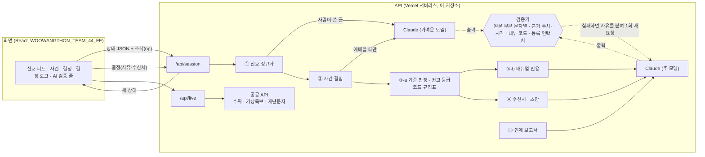

# WOOWANGTHON_TEAM_44_BE

2026 AI 우왕톤 44팀(그라파이트) 「당직메이트」의 시나리오 엔진, AI 파이프라인, 검증기, API입니다. 화면은 `WOOWANGTHON_TEAM_44_FE` 저장소에 있습니다.

지자체 야간 당직자 한 명에게 전화, 기관 통보문, 재난문자, 112·119 공조, 시스템 알림이 흩어져 들어올 때, AI는 같은 사건의 신호를 묶고, 해당 시설의 통제 기준과 매뉴얼 조항을 원문 그대로 인용하며, 보고 초안을 올립니다. 권고 등급은 코드의 규칙표가 정하고, 보고, 통제 검토 요청, 보류는 당직자가 사유와 함께 고릅니다. 시스템은 그 결정과 시각을 기록해 아침 인계 보고서를 만듭니다. AI는 어떤 조치도 직접 실행하지 않으며 실제 발송 기능도 없습니다.

## 바로 확인하기

1. https://woowangthon-44-fe.vercel.app 를 엽니다. AI를 부르는 요청에는 시연 코드가 필요하며, 코드는 최종 제출 폼의 테스트 계정 칸에 적어 두었습니다.
2. 첫 화면 가운데의 안내를 읽고 「재생」을 누릅니다. 기본 시나리오는 가상 「가온시 7월 호우 야간 당직」이고, 120배속이면 결정하는 시간을 빼고 4분 안팎에 신호 17건이 모두 들어옵니다(AI가 신호를 읽는 동안에는 시계가 멈춥니다).
3. 권고 등급이 오르면 재생이 저절로 멈춥니다(04:26, 04:40, 05:31). 가운데에서 기준 판정과 매뉴얼 인용을, 오른쪽에서 AI 초안을 보고 결정을 기록해 봅니다.
4. 위쪽 「AI 검증」 줄에는 이 세션에서 검증기가 한 일(원문 대조를 통과한 인용, 근거 구절을 확인한 사실, 대조한 수치·시각, 검증에 걸린 AI 답)이 실제 집계로 쌓입니다.
5. 끝나면 「인계 보고서 만들기」를 누릅니다. 결정하지 않은 사건은 확인 사항으로 넘어가고, 맨 아래에 AI 검증 기록이 붙습니다.

시나리오 선택에서 「2023년 7월 15일 오송」을 고르면 공식 기록을 바탕으로 재구성한 합성 로그로 같은 흐름을 볼 수 있습니다. 왼쪽 「실시간 연동 보기」는 충청북도의 실제 하천 수위, 기상특보, 긴급재난문자를 참고용으로만 보여 주며 시나리오 판단에는 쓰지 않습니다.

## 구조

```
scenarios/        시나리오 JSON (파일 교체만으로 시나리오 변경)
  gaon-202607-demo.json        기본 시연: 가상 「가온시 7월 새벽 세 시간」, 신호 17건
  osong-20230715-record.json   옵션: 2023.7.15 공식 기록 기반 합성 로그, 신호 11건
src/
  engine.js       세션 상태, 신호 처리 순서, 결정 기록, 재촉, 검증 집계
  stages/
    normalize.js  ① 신호 정규화 (시스템 알림은 규칙, 사람이 쓴 글은 LLM + 근거 구절 검증)
    associate.js  ② 사건 결합 (장소·시설 겹침은 규칙, 애매하면 LLM)
    criteria.js   ③-a 통제 기준 도달 판정과 권고 등급 (코드 규칙표만)
    advise.js     ③-b 매뉴얼 인용 (원문 부분 문자열 검증) / ④ 수신처·전화 스크립트·문자 초안 (수치·시각·내부 코드 검증)
    handover.js   ⑤ 인계 보고서 (표는 코드, 요약만 LLM + 수치·시각 검증, AI 검증 기록)
  llm.js          Claude API 구조화 출력, 검증 실패 시 사유를 붙여 1회 재요청, 호출 상한
  live.js         공공 API 참고 조회 (/api/live)
  metrics.js      평가 지표 계산
api/              Vercel 서버리스 함수 (상태는 클라이언트가 보관)
test/             단위 테스트, API 테스트, 재생 e2e
eval/run.js       같은 시나리오 N회 재생 평가 → eval/results-*.json
```

## 아키텍처



## AI가 하는 일과 코드가 하는 일

기준 도달 여부와 권고 등급(관찰, 보고 권고, 통제 검토 요청 권고), 그리고 결정이 권고를 따라오지 못할 때의 재촉은 코드의 규칙표가 정합니다. 권고가 왜 나왔는지를 당직자가 한 줄로 확인할 수 있어야 하고, 같은 사실이 들어오면 언제나 같은 등급이 나와야 하기 때문입니다. LLM은 사람이 쓴 신호의 이해, 애매한 사건 결합, 조항 선택과 인용, 초안 작성, 인계 요약을 맡습니다.

화면도 이 구분을 그대로 보여 줍니다. AI가 만든 내용에는 점선 「AI」 표지, 규칙표가 정한 등급·판정·재촉에는 실선 「규칙표」 표지, 당직자의 결정에는 채운 「당직자」 표지를 붙였습니다. 시스템 알림처럼 규칙으로 정리한 신호의 요약은 「자동 요약」으로 따로 표시합니다.

LLM 출력은 모두 검증기를 거칩니다. 인용은 매뉴얼 원문의 부분 문자열이어야 화면에 오르고, 신호에서 뽑은 사실은 본문에 근거 구절이 그대로 있어야 하며, 초안과 요약 속 수치와 시각은 근거 신호에 있어야 하고, 수신처는 등록된 연락처 안에서만 고릅니다. 화면 문장에 기준·조항·연락처 id나 영문 판정 코드가 섞여도 검증에 걸립니다. 검증에 실패하면 사유를 붙여 한 번 다시 묻고, 그래도 실패한 인용은 화면에 올리지 않으며, 초안은 경고를 달아 보여 줍니다. 이 과정의 집계는 세션 상태(`state.metrics`)에 쌓여 화면의 「AI 검증」 줄과 인계 보고서의 「AI 검증 기록」에 그대로 나옵니다.

## 설계 결정

- **권고 등급은 규칙표, AI는 근거와 초안.** LLM이 등급까지 정하면 같은 상황에서 등급이 흔들리고 이유를 설명하기 어렵습니다. 통제 기준은 시설마다 숫자로 정해져 있으므로 코드로 판정하고, AI에게는 사람이 쓴 신호를 읽고 근거를 찾아 글로 옮기는 일만 맡겼습니다.
- **인용은 부분 문자열 검사.** 매뉴얼을 「요약해서」 보여 주면 당직자가 원문과 대조할 수 없습니다. 원문에 글자 그대로 있는 구절만 올리고, 문장 중간에서 잘린 인용은 원문 문장 전체로 넓힙니다.
- **수치·시각은 근거 신호 안에서만.** 보고 전화에서 틀린 수위나 시각을 읽는 것이 가장 위험하다고 보고, 초안과 요약의 수치·시각 토큰을 근거 자료와 하나씩 대조합니다. 반올림이나 추정도 허용하지 않습니다.
- **실제 발송 없음.** 「보냈다고 기록」은 당직자가 직접 연락한 뒤 남기는 기록입니다. 발송 기능을 넣으면 AI 출력이 사람 확인 없이 밖으로 나갈 경로가 생기므로 만들지 않았습니다.
- **AI가 읽는 동안 시계를 멈춤.** 신호 한 건 처리에 5~15초가 걸립니다. 재생 시계를 계속 흘리면 처리 지연이 화면에서 사라지므로, 처리 중에는 시계를 멈추고 읽고 있는 신호의 원문을 먼저 보여 줍니다.
- **상태는 클라이언트가 보관.** 서버에 저장소를 두지 않고 세션 상태 JSON을 요청마다 주고받습니다. 서버리스 함수만으로 배포할 수 있고, 개인정보가 서버에 남지 않습니다.
- **시연 코드.** 공개 주소에서 누구나 API 비용을 쓰지 않도록 AI를 부르는 POST 요청에만 코드를 요구합니다(`DEMO_ACCESS_CODE`). 하루 호출 상한(`LLM_DAILY_CALL_CAP`)도 둡니다.

## 실행

Node 20 이상이 필요합니다.

```bash
npm install
cp .env.example .env      # ANTHROPIC_API_KEY 입력 (공공 API 키는 실시간 연동에만 필요)
npm run test:unit         # API 키 없이 도는 테스트
npm test                  # 실제 Claude API로 재생 e2e 포함
npm run dev               # http://localhost:3001 에 /api 실행 (FE의 npm run dev가 여기로 프록시)
npm run replay            # 기본 시나리오 1회 재생 → eval/out/에 상태와 인계 보고서
npm run eval -- gaon-202607-demo 3   # 3회 재생 평가
```

## 검증 결과

2026년 11월 7일, 화면 문장 속 내부 코드 검사를 넣은 뒤 같은 시나리오를 처음부터 끝까지 다시 반복 재생해 측정했습니다(`eval/results-1107.json`, 이전 측정은 `eval/results-1105.json`). 기본 시연 시나리오는 3회, 오송 기록 기반 옵션 시나리오는 2회 돌렸습니다.

기본 시나리오에서는 세 번 모두 신호 17건이 기대한 사건 세 개와 배경 신호로 빠짐없이 나뉘었고, 맨홀 역류와 가로수 쓰러짐 같은 방해 신호가 하천 사건에 섞이지 않았습니다. 보고 권고는 홍수경보 통보(S06) 시점에, 통제 검토 요청 권고는 임시 제방 월류 우려 신고(S07) 시점에 나와 기대한 기한(S10)보다 일렀고, 가로수가 차선을 막은 사건은 신고(S12) 즉시 보고 권고가 됐습니다. 재생이 끝났을 때 화면에 올라 있던 인용(세 번 합계 16건)은 모두 매뉴얼 원문과 일치했고, 초안과 인계 요약에서 근거 신호에 없는 수치나 시각, 화면 문장 속 내부 코드는 발견되지 않았습니다. 다만 세 번 중 두 번은 LLM 답이 검증기에 걸려(모두 3건) 사유를 붙여 다시 물었습니다. 첫 답만 그대로 썼다면 틀린 내용이 화면에 오를 수 있었다는 뜻이므로, 검증기를 빼지 않는 것을 전제로 합니다. 1회 재생에는 LLM 호출 약 25회, 토큰 약 8만 5천, 2분 남짓이 들었습니다.

오송 옵션 시나리오에서는 두 번 모두 신호 11건이 한 사건으로 묶였고, 04:10 홍수경보에서 보고 권고가, 06:26 감리단장 신고에서 통제 검토 요청 권고가 나왔습니다. 이번 두 번은 검증에 걸린 답이 없었습니다. 이 결과는 실제로 여러 기관에 흩어져 들어온 신호가 한 당직 화면에 모였다고 가정했을 때의 재생이며, 당시 판단에 대한 평가가 아닙니다.

평가 과정에서 고친 것도 있습니다. 처음 평가에서는 가로수가 차선을 막은 사건이 매뉴얼상 보고 대상인데도 「관찰」로 남았고, AI가 해당 조항의 앞 문장만 인용했습니다. 그래서 통행 막힘을 보고 권고 규칙에 넣고, 인용이 문장 중간에서 잘리면 원문 문장 전체로 넓히도록 고쳤습니다. 11월 7일 화면 점검에서는 인용 이유 문장에 「C3 met」 같은 내부 코드가 섞여 나오는 것을 발견해, 프롬프트에 금지 문장을 넣고 검증 항목으로 추가했습니다.

## 한계

시나리오가 두 개뿐이고 신호 문장을 직접 썼기 때문에, 실제 전화 메모의 구어체와 오타, 지명 사전에 없는 장소, 서로 어긋나는 신호에 대해서는 아직 검증하지 못했습니다. 신호 한 건 처리에 5~15초가 걸려 신호가 몰리면 처리가 밀립니다. 권고 등급 규칙표는 하천과 지하차도의 통제 기준, 그리고 통행 막힘과 인명 위험에 대한 보고 기준만 다룹니다. 검증기는 인용과 수치·시각이 근거에 있는지는 확인하지만, 근거를 올바르게 해석했는지까지 보장하지는 않으므로 최종 판단은 당직자의 몫으로 남겨 두었습니다.

## 직접 구현한 것과 외부 기술

시나리오 엔진, 신호 정규화와 사건 결합 규칙, 통제 기준 규칙표, 인용·수치·내부 코드 검증기, 재촉 규칙, 인계 보고서 생성, 평가 스크립트, 공공 API 조회 코드는 이 저장소에서 직접 작성했습니다. LLM은 Anthropic Claude API(`claude-haiku-5-5`, `claude-sonnet-5-5`)를 `@anthropic-ai/sdk`로 호출하며, 배포는 Vercel 서버리스 함수(서울 리전)를 씁니다.

## 데이터와 출처

기본 시나리오의 지명, 기관, 매뉴얼, 신호는 모두 시연을 위해 만든 가상 자료입니다.

오송 옵션 시나리오의 신호 시각과 수신 기관은 국무조정실 감찰 조사결과 브리핑(2023.7.28)과 연합뉴스, 문화일보, 서울신문, 시민진상조사위원회·MBC 보도를 바탕으로 재구성했습니다. 신호 본문은 실제 통보문이나 신고 원문이 아니고, 매뉴얼은 실제 청주시·충청북도 매뉴얼이 아닌 데모용 가상 매뉴얼입니다. 재판이 진행 중인 사항은 검찰 공소사실(법원 판단 전 주장)로만 다루며, 임시제방 붕괴 이후 장면과 희생자 관련 정보는 넣지 않았습니다.

화면의 「실시간 연동」은 실제 공공 데이터를 참고용으로만 보여 주며 시나리오 판단에는 쓰지 않습니다. 하천 수위는 한강홍수통제소 수위 Open API, 기상특보는 기상청 기상특보 조회서비스(공공데이터포털), 긴급재난문자는 행정안전부 긴급재난문자(재난안전데이터공유플랫폼, 공공누리 제4유형)에서 가져오며, 재난문자는 원문을 바꾸지 않고 표시합니다. 키는 `HRFCO_KEY`, `DATA_GO_KR_KEY`, `SAFETYDATA_KEY` 환경변수로 넣습니다.
