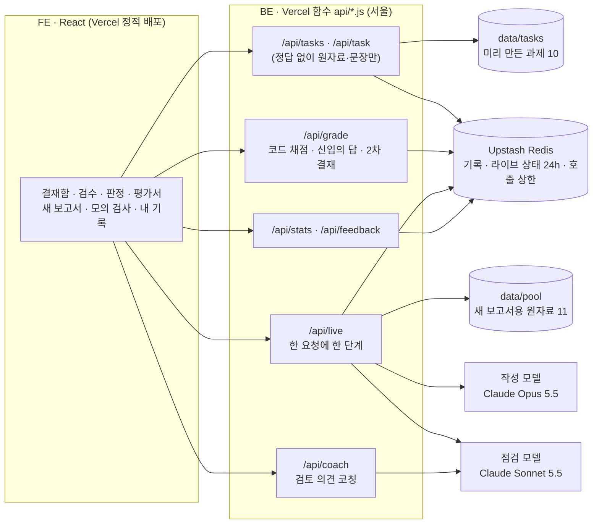

# Redline · AI 결과물 검수 연습 — BE

**AI 활용 평가가 들어간 공채를 준비하는 대학생은 AI가 만든 결과물을 검수하는 연습을 할 곳이 없습니다.** Redline에서는 AI 신입이 실제 공공 자료로 보고서를 써 오되 정해진 곳을 일부러 틀리게 씁니다. 사용자는 원자료와 대조해 틀린 문장에 빨간 줄을 긋고 승인·반려를 판정하며, 코드가 그 결과를 채점합니다.

| | |
|---|---|
| 서비스 | https://woowangthon-44-fe.vercel.app (로그인 없음) |
| 화면 저장소 | https://github.com/woowangthon/WOOWANGTHON_TEAM_44_FE |
| 이 저장소 | 과제 생성 파이프라인, 채점, 새 보고서(라이브) 생성, AI 사수 코칭, 기록 API |
| 팀 | 2026 AI 우왕톤 44팀 그라파이트(1인) |

이 저장소는 11/11까지 다른 주제(당직메이트)에 쓰였습니다. 그 코드는 태그 `dangjikmate-final`과 브랜치 `archive/dangjikmate`에 남아 있고, `main`은 11/11 밤부터 Redline입니다.

---

## 1. 누구의 어떤 문제인가

**대상.** 하반기 공채에서 「AI 활용 역량검사」나 AI 실기 과제를 앞둔 대학생입니다. 문과 직무 지원자도 포함합니다.

**상황.** 채용과 직무 평가에 들어온 AI 역량 검사들은 공통으로 「AI 결과물을 그대로 받지 않고 근거와 대조해 확인하는가」를 봅니다. 그런데 응시자는 검사를 전형 때 한 번 치를 뿐이고, 무엇을 놓쳤는지 돌려받지 못합니다. 지금 할 수 있는 준비는 혼자 문제를 꾸며 풀거나, 다른 취업 준비생이 손으로 만든 문제를 받아 손 채점을 기다리는 정도입니다.

**근거** (모두 원문을 열어 문구를 확인했습니다)
| 출처 | 확인한 내용 |
|---|---|
| OECD·EU 「AI Literacy Framework」(2026) | 「Evaluate whether AI outputs should be accepted, revised or rejected.」를 역량 하나로 둡니다. 초·중등 교육용 틀이라, 역량의 정의로만 인용합니다. |
| HD현대 2026 하반기 신입 공채(파이낸셜뉴스·뉴시스 2026-09-12) | 「AI가 생성한 결과물을 그대로 받아들이는 것이 아니라 이를 비판적으로 분석하고 업무에 맞게 재구성하는 능력까지 평가한다.」 |
| 조코딩AX파트너스 APTA 소개 글(2026-11-02) | 「자료에는 AI가 틀리기 쉬운 내용이 섞여 있어서」 「근거와 대조해 바로잡는지」를 봅니다. 시험은 70분입니다. 형식이 가장 비슷하지만 업체 자료이고, 사례는 채용이 아니라 임직원 평가입니다. |
| 전자신문 2026-09-01(구름 AISA) | 고득점자는 「답변을 검증하며 피드백을 반영하는」 패턴, 저득점자는 「검증 없이 AI의 답변을 그대로 수용」하는 패턴이었습니다. |
| KPMG·멜버른대 47개국 조사(2025) | 「many users rely on AI output without evaluating accuracy (66%)」 |
| 노컷뉴스 2026-05-22 | 인사혁신처가 국외훈련 보고서 1,385건 가운데 11건에서 생성형 AI 부적절 활용을 확정하고 체재비의 4배를 환수하기로 했습니다. |
| 링커리어 커뮤니티 2026-11-10 | 취업 준비생이 「AI가 쓴 초안에서 오류 찾기」 문제를 직접 만들어 나눴습니다. 대표성이 없어 수요 신호로만 씁니다. |

**범위를 좁힌 이유.** 실제 검사는 프롬프트 설계, 결과 검증, 보완을 함께 봅니다. Redline은 그 가운데 **결과 검증**만 떼어 연습합니다. 검사 문항은 공개되지 않았으므로 「실제 검사와 같은 형식」이라고 말하지 않습니다.

## 2. 사용 흐름

1. **결재함.** 오늘 올라온 보고서 목록입니다. 1분 맛보기 1건, 문서 6건, 표 3건이 있고 그중 2건에는 틀린 곳이 없습니다.
2. **업무 지시.** 신입에게 맡긴 일과 검수 기준(「원자료와 다르거나 원자료에 없는 내용은 오류, 문체는 보지 않음, 틀린 곳이 없을 수도 있음」)을 보여 줍니다.
3. **검수.** 왼쪽에 원자료, 오른쪽에 보고서가 나옵니다. 사용자는 문장을 눌러 빨간 줄을 긋고, 사유를 고르고, 검토 의견을 한 줄 씁니다.
4. **판정.** 승인 또는 반려 도장을 찍습니다. 반려하면 신입이 짚인 문장만 고친 수정본을 올리고(2차 결재), 다른 문장이 아직 틀렸는지는 알려 주지 않습니다.
5. **신입의 답.** 맞게 짚은 곳은 고친 문장과 근거 문단을 보여 줍니다. 멀쩡한 문장을 짚었으면 원자료 인용을 들어 되묻습니다. 놓친 곳은 「이대로 나갔습니다」와 함께 최종본에 빨갛게 남습니다.
6. **검토 평가서.** 찾음·놓침·멀쩡한데 짚음과 판정을 보여 줍니다. 놓친 오류마다 「어디서 멈췄어야 했나」를 알려 주고, 같은 문서를 처음 결재한 사람들이 그 오류를 찾은 비율과 AI 사수의 코칭(검토 의견이 정확했는지)을 붙입니다.

그 밖의 기능은 다음과 같습니다.
- **새 보고서 받기:** 결재함과 겹치지 않는 11월 공공 보도자료 11건이나 사용자가 붙여 넣은 글로 AI 신입이 그 자리에서 보고서를 씁니다. 파이프라인 단계가 실제 진행대로 화면에 표시되며, 30초쯤 걸립니다.
- **약점 맞춤:** 내 기록에서 가장 많이 놓친 오류 유형 위주로 심은 새 보고서를 받습니다.
- **모의 검사:** 문서 3건을 12분 안에 결재합니다.

## 3. 무엇이 다른가

**기업의 검사와 다른 점.** 기업의 AI 역량 검사는 기업이 사서 지원자를 한 번 평가하는 도구입니다. Redline은 누구나 미리 여러 번 연습하고, 무엇을 놓쳤는지와 그 이유를 돌려받습니다.

**「챗봇에게 틀린 곳을 넣어 문제를 내 달라고 하면 되지 않나」에 대한 답.** 그렇게 하면 넣었다는 오류가 정말 오류인지, 넣지 않았다는 문장이 정말 맞는지 보장되지 않습니다. 정답을 아는 대화가 채점까지 하게 됩니다. Redline은 다음과 같이 다릅니다.
- 문장마다 원자료 인용을 달고 숫자를 코드로 대조합니다.
- 심은 곳을 코드로 고정하고, 작성과 다른 모델로 오류가 맞는지 검증합니다.
- 채점은 코드가 합니다.
- 같은 문서를 푼 사람끼리 견줍니다.

같은 원자료로 두 방식을 견준 결과는 6절 V7에 있습니다.

## 4. 구성



**파이프라인** (`src/pipeline.js`; 은행 과제는 `scripts/build-task.js`, 새 보고서는 `src/live.js`가 같은 함수를 부릅니다)

| 단계 | 담당 | 입력 → 출력 | 통과 조건 |
|---|---|---|---|
| P0 원자료 | 사람 | 공공누리 제1유형 보도자료 텍스트 → 문단 번호 붙인 JSON | 원문 페이지에서 이용 조건 확인 |
| P1 작성 | 작성 모델(구조화 출력) | 원자료 → 6~8문장, 문장마다 근거 문단과 원자료에서 그대로 딴 인용 | — |
| P2 깨끗함 검증 | 코드 → 점검 모델 | 문장 → 통과/실패 | 인용이 원자료에 글자 그대로 있음, 숫자가 근거 문단에 같은 표기로 있음, 점검 모델이 「원자료가 뒷받침함」. 두 번 실패하면 그 문장을 뺌 |
| P3 오류 심기 | 코드(숫자·단위·방향), 작성 모델(원자료에 없는 주장, 한정어를 뺀 단정) | 문장 → 틀린 문장, 바꾸기 전 문장, 근거, 틀린 까닭 | 심은 값이 근거 문단에 없음, 다른 문장은 그대로 |
| P4 오류 검증 | 코드 + 점검 모델 | 틀린 문장 → 채택/버림 | 코드 검사와 점검 모델이 모두 「틀림」 |
| P5 눈 가린 풀이 | 점검 모델 | 사용자와 같은 화면 → 짚은 문장 | 심지 않은 문장을 짚으면 사람이 다시 봄 |
| P6 사람 확인 | 사람(은행 과제만) | `reports/human-check/<id>.md` 한 장 → 승인 | 원자료와 대조 |

**코드가 맡는 것과 모델이 맡는 것**
- **모델:** 요약 작성, 「원자료에 없는 주장」과 「근거보다 큰 결론」 오류 쓰기, 문장이 원자료로 뒷받침되는지 판정, 눈 가린 풀이, 검토 의견 코칭을 맡습니다.
- **코드:** 오류의 위치와 개수, 숫자·단위·방향 바꾸기, 인용·숫자 대조, 채점, 신입의 답장, 판정의 옳고 그름, 집계를 맡습니다.

채점과 답장은 기록해 둔 바꾸기 전 문장과 근거 인용으로 만들기 때문에 새로 지어내는 글이 없습니다.

**정답 보호.** `/api/task`는 원자료와 문장만 보냅니다. 정답과 오류 수는 채점 응답에만 실립니다. 1차 반려 뒤에 보내는 응답에도 놓친 문장은 넣지 않습니다. 테스트와 `scripts/smoke.js`가 배포 주소에서 이를 확인합니다.

**사용자가 넣은 글.** 붙여 넣은 글은 `<원자료>` 태그 안에 넣어 자료로만 다루고, 출력은 JSON 스키마로 검증합니다. 과제와 함께 24시간 뒤 지웁니다. 검토 의견도 같은 방식으로 다룹니다.

**채점** (`src/grade.js`)
- 찾음, 놓침, 멀쩡한데 짚음을 문장 단위로 셉니다.
- 점수는 공유용 한 숫자로, 찾은 비율 50, 짚은 것 중 맞은 비율 30, 판정 20으로 매깁니다.
- 2차 결재에서 찾은 오류는 절반만 칩니다. 판정 점수는 1차와 2차에 10점씩 나눕니다.
- 수정본에 틀린 곳이 남아 있으면 반려가, 없으면 승인이 맞는 판정입니다.

## 5. 기술 선택

| 선택 | 이유 |
|---|---|
| Vercel 함수 + Upstash Redis, 계정 없음 | 1인 팀이 3주 안에 운영할 수 있는 크기입니다. 기록은 브라우저가 만든 무작위 번호로만 남깁니다. |
| 새 보고서를 한 요청에 한 단계씩 처리하고 상태를 KV에 둠 | 함수 제한 시간 안에 끝나고, 화면의 진행 표시가 서버의 실제 단계와 같아집니다. 고정된 애니메이션이 아닙니다. |
| 작성 Opus, 점검 Sonnet | 작성과 점검을 다른 모델로 나눴습니다. 작성은 긴 원자료를 지시대로 인용하며 요약해야 해서 큰 모델을, 점검은 문장마다 짧게 판정하므로 빠른 모델을 씁니다. |
| 구조화 출력(JSON 스키마) | 문장, 근거 문단, 인용을 칸별로 받아야 코드로 대조할 수 있습니다. |
| 오류를 코드로 심을 수 있는 유형은 코드로 | 숫자·단위·방향은 코드가 바꿔야 「심은 값이 원자료에 없음」을 보장할 수 있습니다. |
| 공공누리 제1유형만 | 원자료를 일부러 틀리게 바꾸므로 변경이 허용된 자료여야 합니다. 뉴스 기사 본문은 쓰지 않습니다. |
| 다른 회사 모델은 견줄 기준의 심판으로만 | 점검을 무료 등급 모델로 바꾸면 할당량이 끊길 때 서비스가 멈춥니다. 그래서 V7 심판으로만 씁니다. |

결정과 바꾼 이유는 팀 Notion의 결정 기록에 날짜별로 남겼습니다.

## 6. 검증

| 항목 | 방법 | 결과 | 남은 문제 |
|---|---|---|---|
| V1 과제 만들기 | 은행 과제 10건을 만든 기록(`reports/v1-pipeline.md`) | 10/10 성공. P2 점검 통과 61/61, P4 「틀림」 판정 32/34(94%). P5 눈 가린 풀이에서 심지 않은 곳을 짚은 경우 0 | P3 코드 검사 통과 34/100. 심을 자리를 넉넉히 시도해야 합니다 |
| V4 새 보고서 | `scripts/v4-live.js`로 새 보고서용 원자료 11건을 한 번씩(`reports/v4/`) | 11/11 성공. 중앙값 33초, 최대 42초. 틀린 곳 없는 보고서 4건. 눈 가린 풀이가 심은 17곳 중 16곳을 찾았고, 심지 않은 곳을 짚은 경우는 0. 호출은 1건에 3~9회(평균 6회) | 사람 확인이 없습니다. 붙여 넣은 글로는 따로 재지 않았습니다 |
| V7 챗봇에게 한 번에 시키기와 견주기 | 같은 원자료 9건. 작성 모델에게 「요약하고 세 문장에 오류를 넣고 정답표를 달라」고 한 번에 시킨 것과 파이프라인 결과를, 정답표를 보지 않는 심판이 문장마다 판정(`reports/v7/`) | 정답표가 어긋난 과제: 한 번에 시키기 2/9, 파이프라인 1/9. 가짜 오류는 둘 다 0. 한 번에 시키기의 어긋남 2건은 「계획」「예정」을 빼고 단정한 문장이 「맞는 문장」으로 적힌 경우 | 파이프라인의 1건은 「최대 18개월」을 요약에서 뺀 문장입니다. 이 서비스 기준(생략은 보지 않음)으로는 오류가 아니지만 그대로 적습니다. 9건이라 우연일 수 있고, 심판(Sonnet)이 점검 모델과 같습니다. 다른 회사 심판(Gemini) 결과는 `reports/v7/README.md`에 덧붙입니다. |
| 채점·정답 보호 | `npm test` 25개(숫자 대조, 오류 심기, 채점, 2차 결재, 코칭 입력, 자료 묶음 분리, API 응답에 정답 없음) | 모두 통과 | — |
| 배포 점검 | `node scripts/smoke.js <BE 주소>` | 운영에서 통과(11/12) | — |
| 사람 확인 | 은행 과제 정답표를 원자료와 대조 | 1/10(G1 과제: 만든 사람이 정답을 보지 않고 풀어 본 뒤 정답표와 대조). 나머지는 진행 중이고, 화면 배지는 「자동 검증」으로 둡니다 | — |
| 실제 사용 | 처음 결재한 사람의 기록(만든 사람 제외), 「도움이 됐나요」 | 집계 중(11/12 기준 만든 사람 판만 있음). 수가 적어도 그대로 적습니다 | — |

## 7. 직접 구현한 것과 외부 기술

- **직접 구현:**
  - 파이프라인 단계와 검사 코드: 인용·숫자 대조, 오류 심기 규칙(조사 맞추기 포함), 눈 가린 풀이 판정
  - 채점과 2차 결재
  - 신입의 답장 틀
  - 새 보고서 단계 실행과 기기별 상한
  - 기록과 집계
  - 모든 화면
- **외부 기술:**
  - Anthropic Claude API: 작성 `claude-opus-5-5`, 점검·코칭 `claude-sonnet-5-5`
  - Google Gemini API: V7 심판만
  - Vercel(호스팅, 함수)
  - Upstash Redis(기록)
  - React, Vite
- **모델 사용 방식:** 모델은 학습시키지 않았습니다. 프롬프트와 출력 스키마를 설계하고, 출력은 모두 코드 검사를 거칩니다.

## 8. API

| 경로 | 하는 일 |
|---|---|
| `GET /api/tasks` | 결재함 목록(트랙, 길이, 푼 사람 수, 배지) |
| `GET /api/task?id=` | 원자료와 문장(정답 없음). `live-…`는 KV에서 읽음 |
| `POST /api/grade` | `rounds:[{marks,decision}]`를 받아 채점. 1차 반려면 수정본만 돌려주고 기록하지 않음 |
| `GET /api/live`, `POST /api/live` | 새 보고서 자료 목록, `start`·`step`(한 번에 한 단계) |
| `POST /api/coach` | 끝난 결재의 검토 의견을 코칭(기기당 하루 20번) |
| `GET /api/stats`, `POST /api/feedback` | 집계(처음 결재한 판만, 만든 사람 제외), 반응 |

**호출 상한.** 모델 호출은 `src/llm.js` 한 곳에서 하고, 한국 시각 날짜별 하루 상한(기본 300회)을 KV에서 셉니다. 새 보고서는 기기당 하루 3번까지입니다.

## 9. 실행

```
npm ci
npm test                         # 단위·API 테스트(모델 호출 없음)
npm run dev                      # http://localhost:3001, KV가 없으면 메모리에 기록
node scripts/smoke.js [BE 주소]   # 목록 → 과제 → 1차 반려 → 2차 결재 → 집계, 정답 노출 검사
node --env-file=.env scripts/build-task.js data/sources/<id>.json --difficulty 2   # 과제 만들기(모델 호출 약 6회)
node --env-file=.env scripts/v4-live.js 11                                     # V4
node --env-file=.env scripts/v7-baseline.js gen | judge --judge sonnet|gemini   # V7
```
환경 변수 이름은 `.env.example`에 있습니다. 키는 서버 환경 변수에만 둡니다.

## 10. 한계

- 이 연습이 실제 업무의 검수 실력으로 옮겨 가는지는 재지 못했습니다.
- 빠뜨린 내용은 다루지 않습니다. 누를 문장이 있는 오류만 다룹니다.
- 틀린 곳이 있다는 것을 알고 하는 검수는 실제와 다를 수 있습니다. 그래서 틀린 곳이 없는 과제를 섞고, 화면마다 「틀린 곳이 없을 수도 있다」고 알립니다.
- 작성과 점검이 같은 회사(Anthropic)의 모델이라 같은 실수를 함께 놓칠 수 있습니다.
- 새 보고서는 사람이 확인하지 않습니다. 화면에 그렇게 표시합니다.
- 표의 증감·합계를 새로 계산한 값은 아직 오류로 심지 않습니다.
- 이 저장소는 공개라 `data/tasks/`와 `reports/`에서 정답을 볼 수 있습니다. 연습 서비스라 감추지 않습니다.

## 11. 데이터 출처

- **원자료:** 모두 정책브리핑(korea.kr)에 실린 정부 부처 보도자료의 텍스트이고, 공공누리 제1유형(출처표시)입니다. 문서마다 제목, 발행처, 주소, 가져온 날짜, 이용 조건을 `data/sources/*.json`과 `data/pool/*.json`의 `source`에 적었고, 화면의 「첨부 원자료」에도 원문 링크를 붙였습니다.
  - 결재함 10건: 국가데이터처, 고용노동부, 과학기술정보통신부, 국토교통부, 지식재산처, 행정안전부
  - 새 보고서 11건: 금융위원회, 관세청, 문화체육관광부, 고용노동부, 외교부, 재정경제부, 국토교통부, 인사혁신처, 중소벤처기업부, 국세청
- **변경 고지:** 보고서는 원자료를 요약하고 일부를 일부러 틀리게 바꾼 연습용 글입니다. 화면마다 이를 밝힙니다.
- **오픈소스:** `@anthropic-ai/sdk`(Apache-2.0). 화면 쪽은 FE 저장소의 README에 있습니다.
